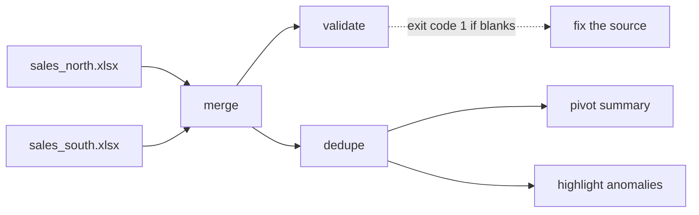

# excel-automation-scripts

Five small Python scripts that merge, dedupe, validate, pivot and flag outliers in Excel files, using pandas and openpyxl.

I wanted to practise the spreadsheet chores that fill a lot of office work, but as scripts I can test and rerun instead of clicking through Excel each time. Everything here runs on made-up data; there is nothing real in the repo.

## What it does to the sample data

The sample sales files (synthetic, generated by `scripts/make_samples.py`) have three problems planted in them: a duplicated order, a blank product, and one absurd `units` value. This is the real output of running the scripts in order:

```
$ python scripts/merge_workbooks.py sample_input/sales_north.xlsx sample_input/sales_south.xlsx -o sample_output/merged.xlsx
merged 2 files -> 25 rows, wrote sample_output/merged.xlsx

$ python scripts/validate_columns.py sample_output/merged.xlsx --required order_id region product units price
INVALID
 - blank in 'product' at Excel row(s): 19

$ python scripts/dedupe_rows.py sample_output/merged.xlsx -o sample_output/deduped.xlsx
25 rows in, 1 duplicates removed, 24 rows out -> sample_output/deduped.xlsx

$ python scripts/pivot_summary.py sample_output/deduped.xlsx -o sample_output/pivot.xlsx --index product --columns region --values units --agg sum
region    North  South   All
product                     
Folder       12     20    32
Notebook    911     31   942
Pen          64     29    93
Stapler      30     37    67
All        1017    117  1134

$ python scripts/highlight_anomalies.py sample_output/deduped.xlsx -o sample_output/highlighted.xlsx --column units
1 anomalies in 'units' at Excel row(s): 5
```

Before and after for the outlier: order 1003 has `units` = 900 in the merged file, and `highlighted.xlsx` has that one cell filled yellow. The 900 is also why Notebook shows 911 for North in the pivot. The full unedited terminal log is in [sample_output/real_run.txt](sample_output/real_run.txt).

## Quick start

```bash
git clone https://github.com/YazanAlshareef/excel-automation-scripts.git
cd excel-automation-scripts
pip install -r requirements.txt
python scripts/merge_workbooks.py sample_input/sales_north.xlsx sample_input/sales_south.xlsx -o merged.xlsx
python -m pytest -q
```

## The scripts

All of them take `--help`. Output paths must differ from input paths; the scripts refuse to overwrite their own input.

| Script | What it does | Usage |
|---|---|---|
| `merge_workbooks.py` | Stacks the first sheet of several workbooks and adds a `source_file` column | `merge_workbooks.py a.xlsx b.xlsx -o out.xlsx` |
| `dedupe_rows.py` | Drops duplicate rows, keeping the first (all columns, or just `--keys`) | `dedupe_rows.py in.xlsx -o out.xlsx [--keys id]` |
| `validate_columns.py` | Checks required columns exist and have no blank or whitespace-only cells; exits 1 if not | `validate_columns.py in.xlsx --required id units` |
| `pivot_summary.py` | Pivot table with totals (sum, mean, count, min, max) | `pivot_summary.py in.xlsx -o out.xlsx --index product --values units` |
| `highlight_anomalies.py` | Fills outliers in a numeric column yellow, using the IQR rule | `highlight_anomalies.py in.xlsx -o out.xlsx --column units` |

## How the pieces fit



Each script stands alone. The diagram shows the order I used on the sample data, nothing forces it.

## Diagrams

- [Components](docs/diagrams/components.md): scripts, helper, libraries and files
- [Sequences](docs/diagrams/sequences.md): merge and validate flows
- [Highlight anomalies logic](docs/diagrams/highlight-anomalies.md): decision steps of the highlighter

## What went wrong along the way

No test failed on the final run, but I ran into a few things and designed around them.

- **Outlier rule.** I used IQR instead of a z-score. One extreme value inflates the mean and standard deviation and can hide itself, and on a tiny table a z-score of 3 may not be reachable at all.
- **Row numbers.** pandas row 0 is Excel row 2, because of the header and 1-based rows. Reports add 2, and the tests pin exact rows (19 and 5).
- **Whitespace.** A cell with only spaces looks empty in Excel, so `validate_columns.py` counts it as blank.
- **Blank group keys.** The pivot silently leaves out the row with a blank `product`, because pandas drops missing group keys. That is the reason `validate_columns.py` exists; run it first.
- **Review fixes.** A review found that the highlighter edited the active sheet, not the first sheet pandas read, that an output path equal to an input would overwrite it, and that `--agg mean` on a text column gave a traceback. All fixed, each with a test. Later I added clean errors for a missing input file and for a non-numeric `--column`.

## Limits

- Only the first sheet of each workbook is read, and the highlighter edits that same sheet.
- Everything loads into memory. Fine for thousands of rows, untested beyond that.
- openpyxl keeps cell styles when it re-saves, but charts, images and some other features can be lost.
- `merge_workbooks.py` writes text starting with `=` back as an Excel formula, so only merge files you trust.
- IQR flags unusual values, not wrong ones.
- Dedupe compares exact values, so `Pen` and `pen ` are different.
- Not tested on `.xls`, password-protected files or very large files. I never opened the outputs in desktop Excel; I checked the yellow fill by reading it back with openpyxl in a test.
- Tests passed locally (20 tests, Python 3.12, pandas 3.0.5, openpyxl 3.1.5). The GitHub Actions workflow runs the same `pytest` on Ubuntu and Windows, but I have not seen its result yet.

See [WALKTHROUGH.md](WALKTHROUGH.md) for what each file does.

## License

MIT, see [LICENSE](LICENSE).
