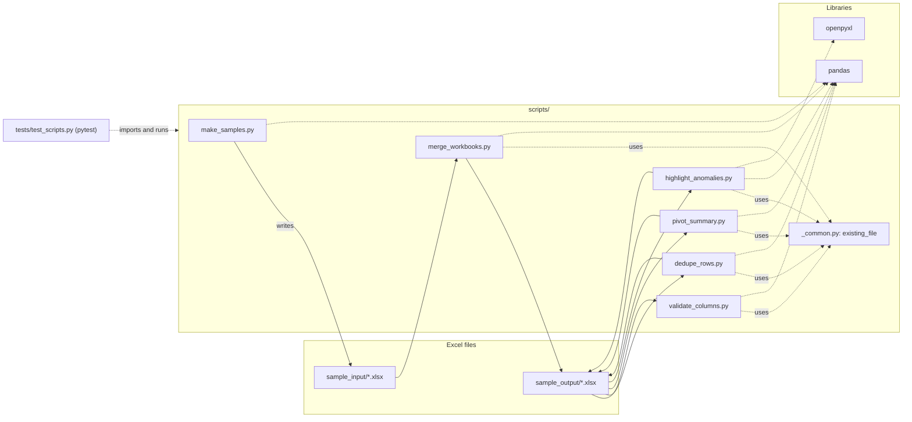

# Components

Which scripts, helpers, libraries and files make up the repo.

Sources: [scripts/_common.py](../../scripts/_common.py), [scripts/merge_workbooks.py](../../scripts/merge_workbooks.py), [scripts/dedupe_rows.py](../../scripts/dedupe_rows.py), [scripts/validate_columns.py](../../scripts/validate_columns.py), [scripts/pivot_summary.py](../../scripts/pivot_summary.py), [scripts/highlight_anomalies.py](../../scripts/highlight_anomalies.py), [scripts/make_samples.py](../../scripts/make_samples.py), [tests/test_scripts.py](../../tests/test_scripts.py)

