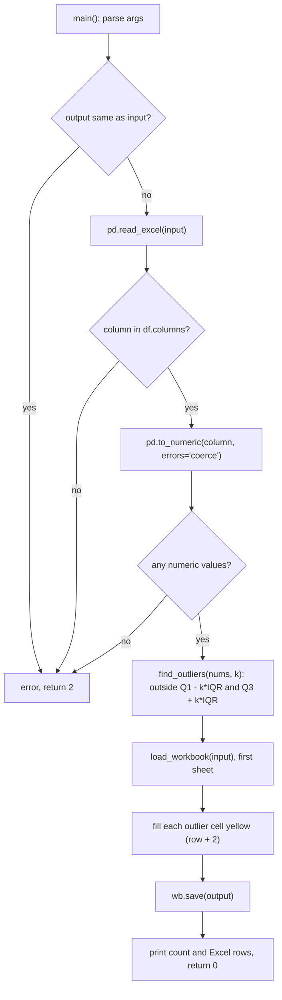

# Highlight anomalies logic

The decision steps in `highlight_anomalies.py`, from argument checks to the saved workbook.

Sources: [scripts/highlight_anomalies.py](../../scripts/highlight_anomalies.py), [scripts/_common.py](../../scripts/_common.py)

