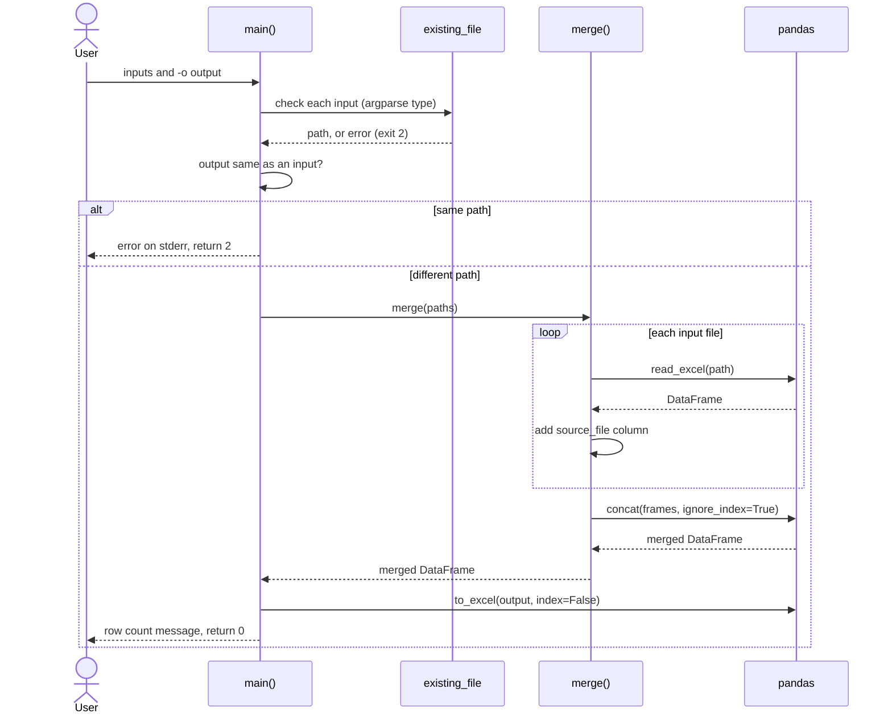
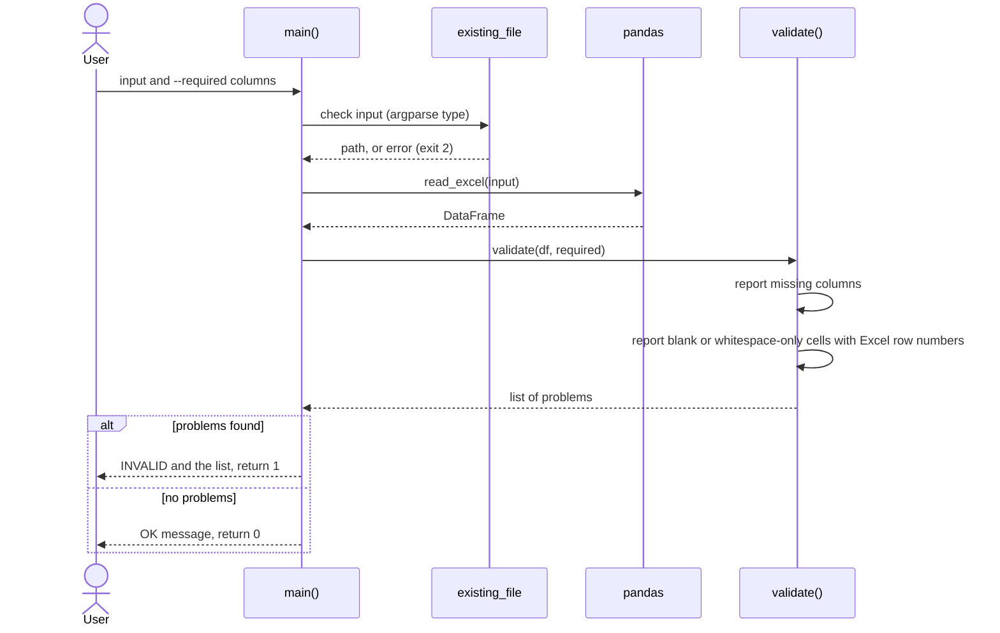

# Sequences

Two key flows: merging workbooks, and validating columns.

## Merge workbooks

Command line run of `merge_workbooks.py`: input checks, the output-equals-input guard, then merge and write.

Sources: [scripts/merge_workbooks.py](../../scripts/merge_workbooks.py), [scripts/_common.py](../../scripts/_common.py)

## Validate columns

Command line run of `validate_columns.py`: how the exit code is chosen.

Sources: [scripts/validate_columns.py](../../scripts/validate_columns.py), [scripts/_common.py](../../scripts/_common.py)

